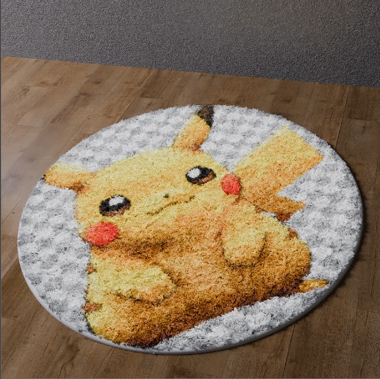

# 🧶 Cartoon Rug — Blender 3D Project

A cartoon-style 3D rug created in Blender as a portfolio project.

## 🛠️ Skills Demonstrated

- 3D modeling
- UV mapping
- Image texturing
- Fur/fiber creation
- Material setup
- PBR workflow
- Lighting and rendering
- OBJ-ready asset workflow

## 🎨 Project

The rug was modeled and textured in Blender, with a printed cartoon design applied to the surface and a short fiber/fur material used to create the rug appearance.

## 📦 Files

- `Rug.blend` — Blender source file
- `Cartoon_Rug_Render.PNG` — Final render

## 🖥️ Software

- Blender

## Author

Gursehbaj Singh
3D Modeling & Blender Artist
